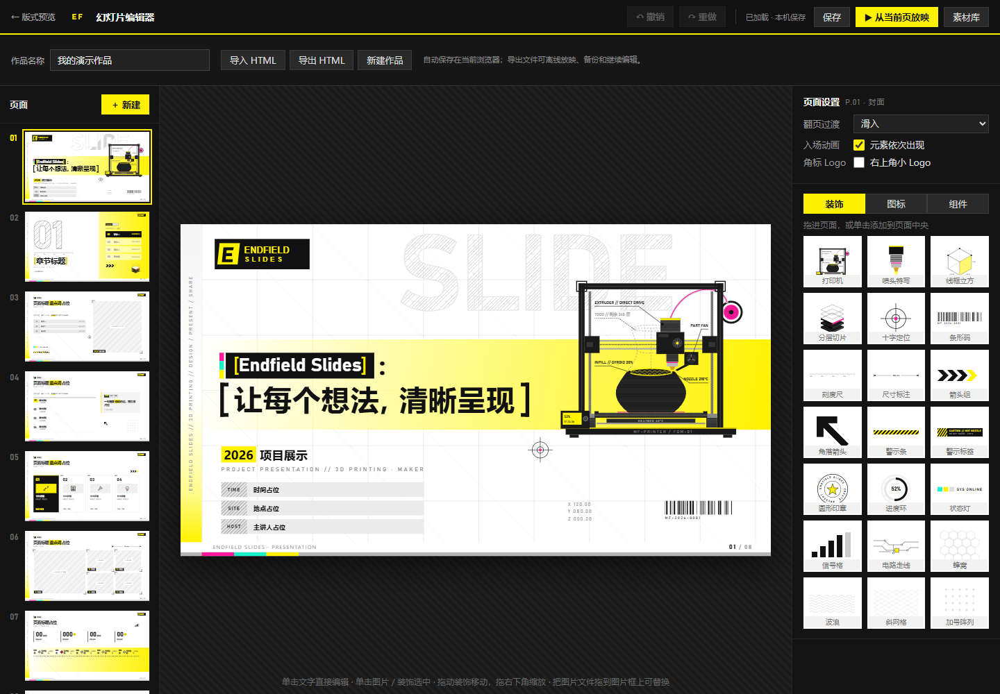

# Endfield Slides

终末地风格的网页幻灯片编辑器。采用黑黄配色、工程网格、编号标签与打印主题动效，打开浏览器即可制作、保存和放映。



## 功能

- **8 种版式**：封面、章节过渡、图文、普通内容、多卡片、图集、数据与时间线、结尾。
- **可视化编辑**：直接改文字、加粗或高亮，替换图片、调整图片裁切。
- **素材与排版**：16 个图标、21 种装饰，支持拖动、缩放、透明度及前后层级。
- **页面管理**：新建、复制、删除、拖动排序，支持撤销与重做。
- **放映**：全屏显示、键盘翻页、入场动画、翻页过渡与动态 SVG。
- **本机保存**：内容与图片保存在当前浏览器的 IndexedDB，不需要账号或数据库。
- **HTML 导入导出**：导出文件内嵌样式、脚本和图片，离线也能放映；重新导入后继续编辑。
- **手机布局**：可切换页面列表、画布及设置与素材面板。

## 开始使用

克隆或下载本仓库，安装 Python 3 后双击 **`启动编辑器.bat`**。也可以在项目目录运行：

```sh
python tools/serve.py
```

浏览器打开 **http://127.0.0.1:8800/**。端口被占用时可改用：

```sh
python tools/serve.py --port 8810
```

这是纯静态项目，也可以部署到 GitHub Pages 或其他静态托管服务的任意子目录，无需构建步骤。编辑器需要 HTTP(S) 环境，不要直接双击 `index.html`；导出的单文件 HTML 可以直接双击放映。

## 保存与备份

停止编辑后约两秒自动保存，也可点击“保存”或按 `Ctrl+S`。保存位置是**当前浏览器、当前网站地址**，不会随账号同步到其他设备。清理站点数据、使用无痕窗口或更换浏览器，都可能使本机内容不可用。

使用“导出 HTML”保存一份独立文件，既可备份，也可分享给别人直接放映。导入或新建会替换当前作品，请先导出需要保留的内容。

上传图片只在浏览器中读取，不发送到服务器。支持 PNG、JPG、WebP、GIF 和 SVG，单张不超过 20 MB。导入支持此工具导出的 HTML，最多 200 页、文件不超过 100 MB。

## 常用操作

| 操作 | 方法 |
| --- | --- |
| 编辑文字 | 单击文字；Enter 完成，Shift+Enter 换行 |
| 替换图片 | 选中图片后选择文件，或将图片拖到图片框 |
| 移动装饰 | 拖动；方向键微调，Shift 每次移动 10px |
| 缩放装饰 | 拖右下角控制点，或在右侧设置宽度 |
| 保存 | Ctrl+S |
| 撤销 / 重做 | Ctrl+Z / Ctrl+Y |
| 从当前页放映 | 点击顶部放映按钮 |
| 全屏 / 翻页 / 退出 | F / ← → / Esc |

## 文件结构

```text
index.html       编辑器入口
template.html    初始演示与版式预览
layouts.html     新建页面使用的 8 种版式
assets.html      素材库
present.html     放映页
css/             幻灯片主题、动画及编辑器样式
js/editor.js     编辑交互
js/online.js     本机保存、图片读取与 HTML 导入导出
js/slides.js     页码装饰、放映控制与动画
assets/          SVG 图标和装饰（含 2 个动效变体）
img/             通用标志与不可扫描的二维码占位图
tools/serve.py   本地静态预览服务
tests/           文件引用与隐私检查
```

修改默认版式时，编辑 `template.html` 和 `layouts.html` 中 `SLIDES:BEGIN` 与 `SLIDES:END` 之间的页面。样式集中在 `css/theme.css`。这是 HTML 演示工具，当前没有 PPTX 导出。

## 检查

安装 Node.js 18 或更新版本后运行：

```sh
node --test tests/project.test.mjs
```

检查本地文件引用、默认版式数量、禁止上传的运行数据、常见密钥格式及个人联系方式。提交前仍应检查自己添加的素材和导出文件。

## 项目说明

这是非官方的风格化界面项目，与《明日方舟：终末地》官方没有关联；仓库不包含游戏标志、角色立绘或游戏专有字体。默认素材为通用 SVG 图形和占位内容，未包含原始使用场景的联系人、二维码、照片、账号凭据及历史记录。
